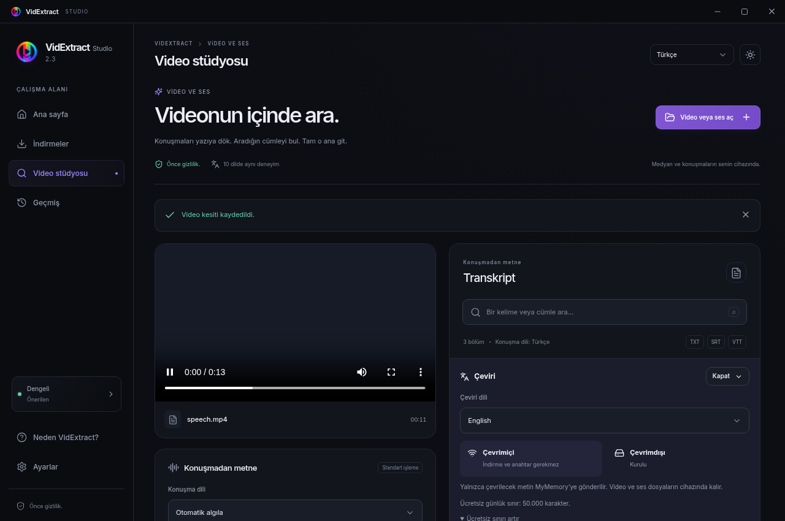
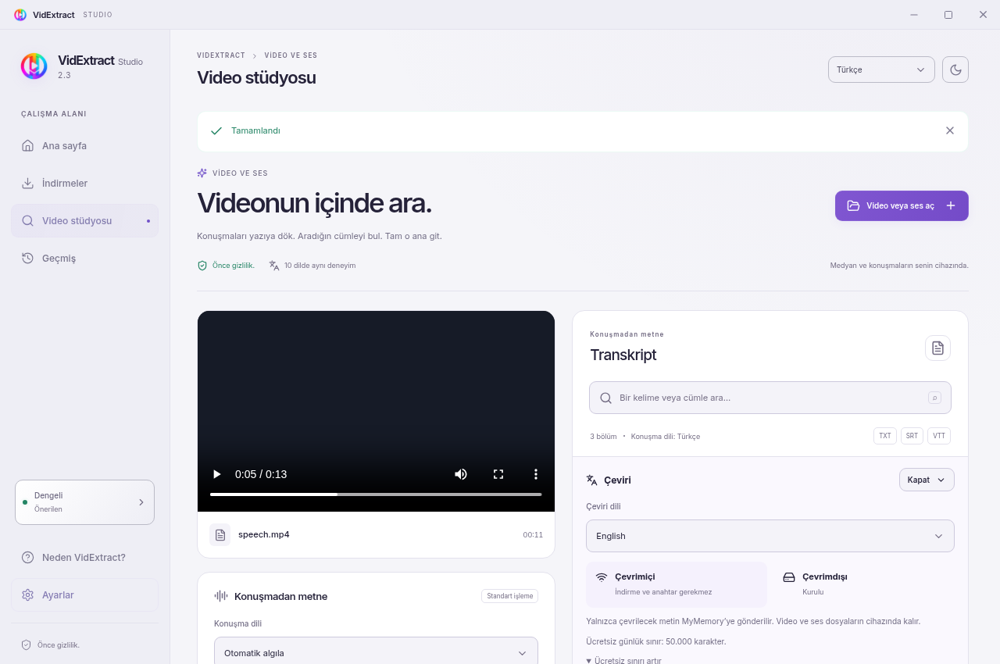

<p align="center"><a href="README.md">English</a> &nbsp; / &nbsp; <a href="docs/README.tr.md">Türkçe</a></p>
<p align="center"></p>
<p align="center"><a href="https://github.com/idginity124/VidExtract/releases">Download</a> &nbsp; / &nbsp; <a href="BUILDING.md">Build guide</a> &nbsp; / &nbsp; <a href="PRIVACY.md">Privacy</a> &nbsp; / &nbsp; <a href="https://buymeacoffee.com/ekrembulgan">Support</a></p>

<br>
<p align="center">A desktop workspace for downloading media, transcribing speech locally and finding the exact moment you need.<br>Translate beside the original, export subtitles or save a video clip.</p>
<p align="center"><sub>Tauri 2 · React · Rust · whisper.cpp · CTranslate2 · GPLv3</sub></p>
<p align="center"><a href="docs/screenshots/studio-dark.png"></a></p>
<details>
<summary>Light theme preview</summary>

<p align="center"><a href="docs/screenshots/studio-light.png"></a></p>

</details>

<h2 align="center">From a video to a useful transcript</h2>
<table align="center"><tr><th align="center">Download</th><th align="center">Find</th><th align="center">Keep</th></tr><tr><td align="center">Video, audio, playlists and a download queue.</td><td align="center">Automatic language detection and timestamp search.</td><td align="center">Side-by-side translation, TXT/SRT/VTT and MP4 clips.</td></tr></table>
<p align="center">Ten interface languages, including Arabic RTL, with light and dark themes.</p>
<h2 align="center">Download</h2>

| Platform | Package | Before you start |
|---|---|---|
| Windows x64 | [EXE](https://github.com/idginity124/VidExtract/releases) | Windows 10/11; WebView2 runtime required |
| Linux x64 | [AppImage](https://github.com/idginity124/VidExtract/releases) | Make executable before launching |
| Debian / Ubuntu x64 | [DEB](https://github.com/idginity124/VidExtract/releases) | `sudo apt install ./VidExtract_*.deb` |

<p align="center">Microsoft Store publication is being prepared. The unsigned <code>-store.msix</code> is for Partner Center submission, not ordinary installation.</p>
<details>
<summary>Installation and validation notes</summary>

```bash
chmod +x VidExtract_*.AppImage
./VidExtract_*.AppImage
```

Windows EXE installers are currently unsigned. Packages are built locally. Windows workers were tested through Wine; native Windows GUI testing and Store certification remain pending. Distribution and GPU compatibility varies. [Validation scope](docs/VALIDATION.md).

Verify the attached platform SHA-256 manifest if needed.

</details>

<h2 align="center">Choose how to process your media</h2>
<table align="center"><tr><th align="center">Local transcription</th><th align="center">Online translation</th><th align="center">Offline translation</th></tr><tr><td align="center">Speech recognition runs on your device. Optional Vulkan acceleration with CPU fallback.</td><td align="center">MyMemory needs no account or API key. Selected text is sent to the provider.</td><td align="center">Download only the required language packs. Translation text stays on your device.</td></tr></table>
<details>
<summary>Models, language packs and limits</summary>

Speech models download on request: Tiny ~78 MB, Base ~148 MB, Small ~488 MB. CPU/RAM measurements guide model and thread recommendations. Long recordings are processed in bounded sections.

Offline translation packs are approximately 65–286 MB each. Some pairs need two packs through English; the missing download size is shown before installation. Completed translation segments are cached locally.

MyMemory’s published allowance is 5,000 characters/day anonymously, or 50,000 with a valid optional email. [Provider limits](https://mymemory.translated.net/doc/usagelimits.php) may change.

Languages: Turkish, English, Spanish, French, German, Portuguese, Russian, Arabic, Hindi and Chinese. Interface, speech and translation choices are independent.

</details>

<p align="center">Automatic transcripts and translations can contain errors. Download only media you are authorized to access and save.</p>
<h2 align="center">Build and contribute</h2>
<p align="center">The desktop source is open under GPLv3. Start with the build guide for dependencies and platform-specific setup.</p>
<p align="center"><a href="BUILDING.md">BUILDING</a> &nbsp; / &nbsp; <a href="CONTRIBUTING.md">CONTRIBUTING</a> &nbsp; / &nbsp; <a href="https://github.com/idginity124/VidExtract/issues">Issues</a> &nbsp; / &nbsp; <a href="LICENSE">GPLv3</a> &nbsp; / &nbsp; <a href="THIRD_PARTY.md">Third-party licenses</a></p>

<br>
<p align="center"></p>
<p align="center"><a href="https://www.ekrembulgan.com">Ekrem Bulgan</a> &nbsp; / &nbsp; <a href="https://linkedin.com/in/ekrembulgan">LinkedIn</a></p>
<p align="center"><sub>© 2026 Ekrem Bulgan · GPL-3.0-only</sub></p>
