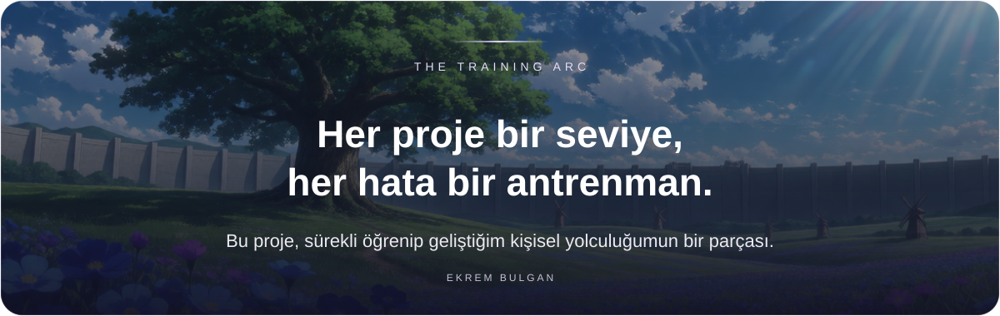

<p align="center"><a href="../README.md">English</a> &nbsp; / &nbsp; <a href="README.tr.md">Türkçe</a></p>
<p align="center"></p>
<p align="center"><a href="https://github.com/idginity124/VidExtract/releases">İndir</a> &nbsp; / &nbsp; <a href="../BUILDING.md">Derleme rehberi</a> &nbsp; / &nbsp; <a href="../PRIVACY.md">Gizlilik</a> &nbsp; / &nbsp; <a href="https://buymeacoffee.com/ekrembulgan">Destek ol</a></p>

<br>
<p align="center">Video indirme, cihazda konuşma tanıma ve aradığın ana ulaşmak için tek bir masaüstü çalışma alanı.<br>Orijinal metnin yanında çevir, altyazı olarak dışa aktar veya video klibi kaydet.</p>
<p align="center"><sub>Tauri 2 · React · Rust · whisper.cpp · CTranslate2 · GPLv3</sub></p>
<p align="center"><a href="../docs/screenshots/studio-dark.png"></a></p>
<details>
<summary>Açık tema önizlemesi</summary>

<p align="center"><a href="../docs/screenshots/studio-light.png"></a></p>

</details>

<h2 align="center">Videodan kullanılabilir bir metne</h2>
<table align="center"><tr><th align="center">İndir</th><th align="center">Bul</th><th align="center">Kaydet</th></tr><tr><td align="center">Video, ses, oynatma listeleri ve indirme kuyruğu.</td><td align="center">Otomatik dil algılama ve zaman damgalı arama.</td><td align="center">Yan yana çeviri, TXT/SRT/VTT ve MP4 klipleri.</td></tr></table>
<p align="center">Arapça sağdan sola görünüm dahil on arayüz dili; açık ve koyu tema.</p>
<h2 align="center">İndir</h2>

| Platform | Paket | Başlamadan önce |
|---|---|---|
| Windows x64 | [EXE](https://github.com/idginity124/VidExtract/releases) | Windows 10/11; WebView2 çalışma zamanı gerekir |
| Linux x64 | [AppImage](https://github.com/idginity124/VidExtract/releases) | Açmadan önce çalıştırma izni ver |
| Debian / Ubuntu x64 | [DEB](https://github.com/idginity124/VidExtract/releases) | `sudo apt install ./VidExtract_*.deb` |

<p align="center">Microsoft Store yayını hazırlanıyor. İmzasız <code>-store.msix</code> dosyası normal kurulum için değil, Partner Center gönderimi içindir.</p>
<details>
<summary>Kurulum ve doğrulama notları</summary>

```bash
chmod +x VidExtract_*.AppImage
./VidExtract_*.AppImage
```

Windows EXE kurulumları şu anda imzasızdır. Paketler yerel bilgisayarda üretilir. Windows araçları Wine üzerinden denendi; gerçek Windows arayüz testi ve Store sertifikasyonu henüz tamamlanmadı. Dağıtım ve GPU uyumluluğu değişebilir. [Doğrulama kapsamı](VALIDATION.md).

Gerekirse sürümün yanında sunulan SHA-256 dosyasıyla doğrula.

</details>

<h2 align="center">Medyanı nasıl işleyeceğini seç</h2>
<table align="center"><tr><th align="center">Cihazda konuşma tanıma</th><th align="center">Çevrimiçi çeviri</th><th align="center">Çevrimdışı çeviri</th></tr><tr><td align="center">İşlem cihazında çalışır. İsteğe bağlı Vulkan hızlandırması ve CPU ile devam desteği.</td><td align="center">MyMemory için hesap veya API anahtarı gerekmez. Seçilen metin sağlayıcıya gönderilir.</td><td align="center">Yalnızca gerekli dil paketlerini indir. Çeviri metni cihazında kalır.</td></tr></table>
<details>
<summary>Modeller, dil paketleri ve sınırlar</summary>

Konuşma modelleri istek üzerine indirilir: Tiny ~78 MB, Base ~148 MB, Small ~488 MB. CPU/RAM ölçümleri model ve iş parçacığı önerilerine yardımcı olur. Uzun kayıtlar sınırlı uzunlukta bölümlerle işlenir.

Çevrimdışı çeviri paketleri yaklaşık 65–286 MB boyutundadır. Bazı dil çiftleri İngilizce üzerinden iki paket gerektirir; eksik indirme boyutu kurulumdan önce gösterilir. Tamamlanan çeviri bölümleri yerel olarak önbelleğe alınır.

MyMemory’nin yayımlanan kotası anonim kullanımda 5.000 karakter/gün; geçerli ve isteğe bağlı e-posta ile 50.000 karakter/gündür. [Sağlayıcı sınırları](https://mymemory.translated.net/doc/usagelimits.php) değişebilir.

Diller: Türkçe, İngilizce, İspanyolca, Fransızca, Almanca, Portekizce, Rusça, Arapça, Hintçe ve Çince. Arayüz, konuşma ve çeviri dili bağımsız seçilir.

</details>

<p align="center">Otomatik metinler ve çeviriler hata içerebilir. Yalnızca erişme ve kaydetme iznin olan içerikleri indir.</p>
<h2 align="center">Derle ve katkıda bulun</h2>
<p align="center">Masaüstü kaynak kodu GPLv3 ile açık. Bağımlılıklar ve platform kurulumu için derleme rehberinden başla.</p>
<p align="center"><a href="../BUILDING.md">BUILDING</a> &nbsp; / &nbsp; <a href="../CONTRIBUTING.md">CONTRIBUTING</a> &nbsp; / &nbsp; <a href="https://github.com/idginity124/VidExtract/issues">Issues</a> &nbsp; / &nbsp; <a href="../LICENSE">GPLv3</a> &nbsp; / &nbsp; <a href="../THIRD_PARTY.md">Üçüncü taraf lisansları</a></p>

<br>
<p align="center"></p>
<p align="center"><a href="https://www.ekrembulgan.com">Ekrem Bulgan</a> &nbsp; / &nbsp; <a href="https://linkedin.com/in/ekrembulgan">LinkedIn</a></p>
<p align="center"><sub>© 2026 Ekrem Bulgan · GPL-3.0-only</sub></p>
